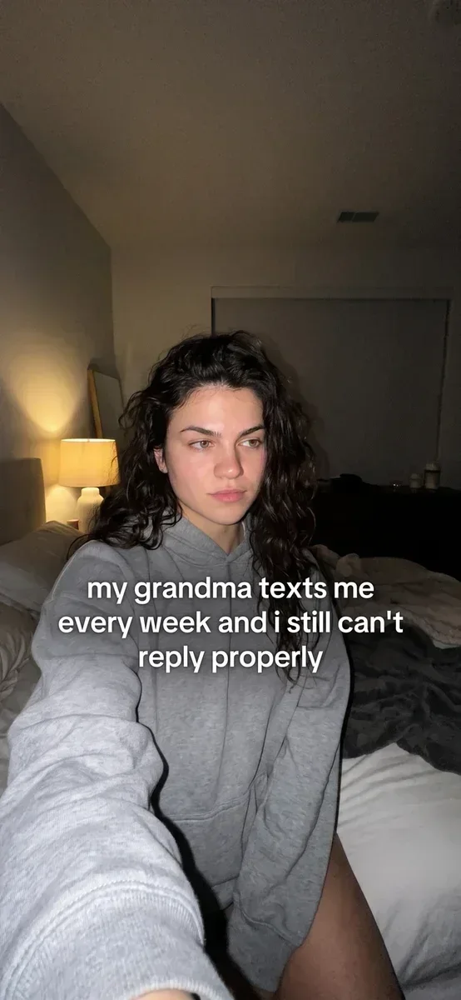
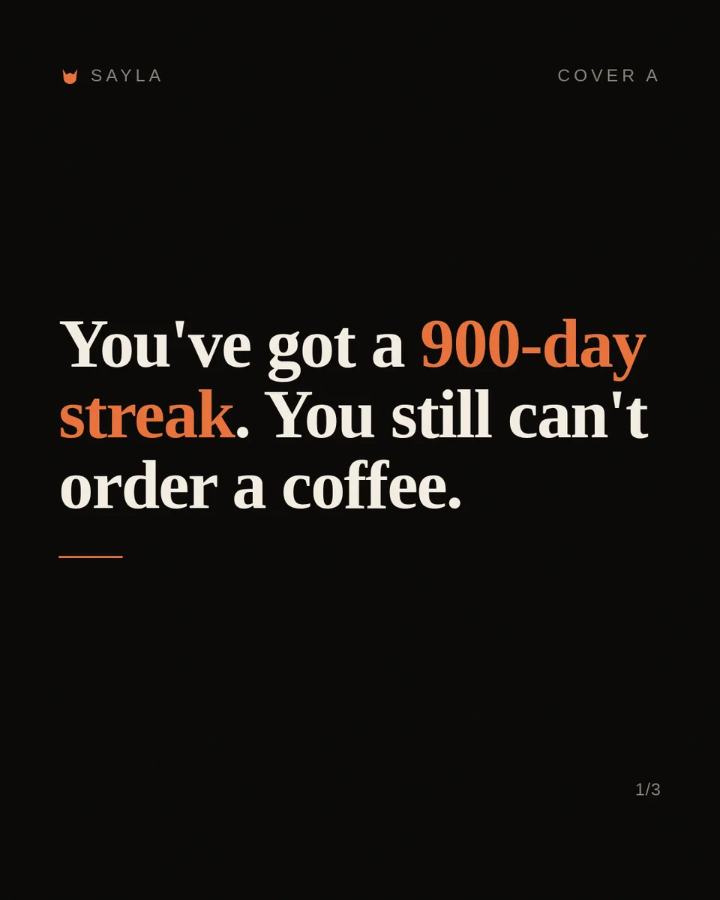
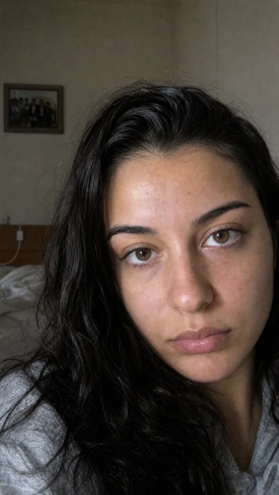
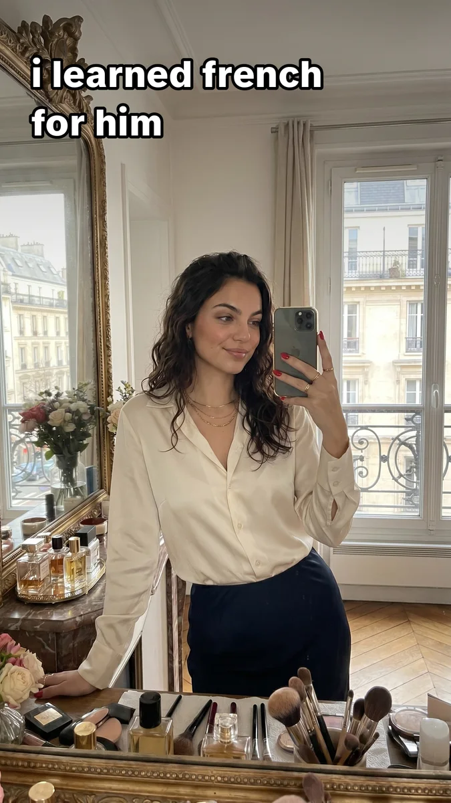
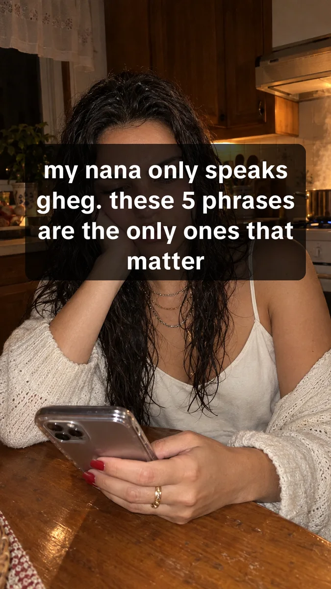
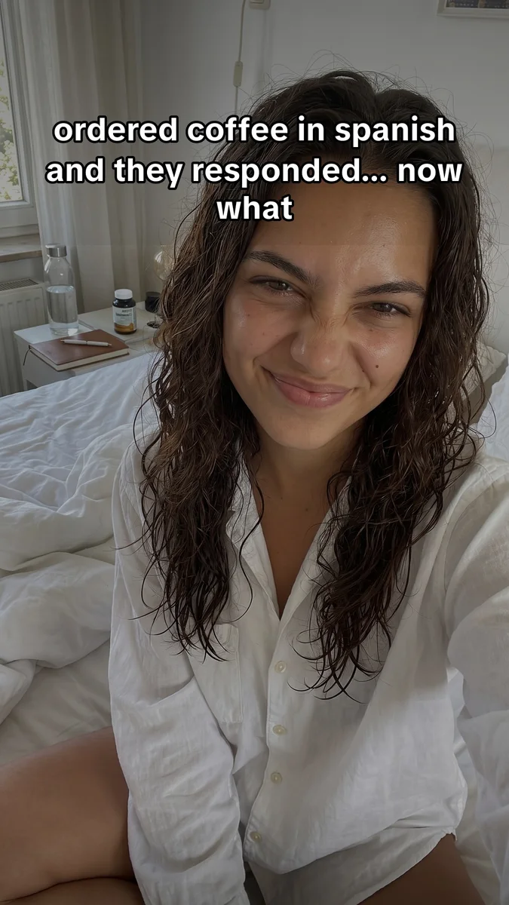
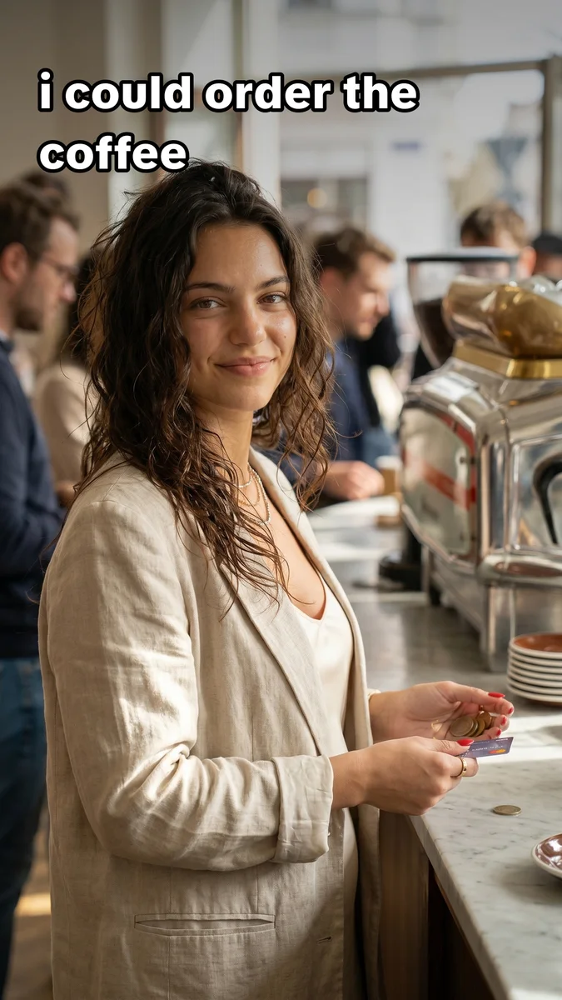
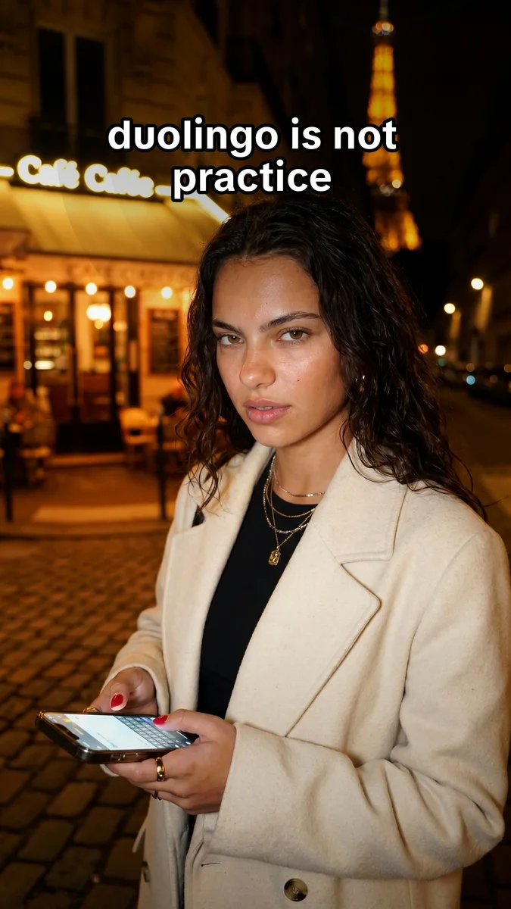
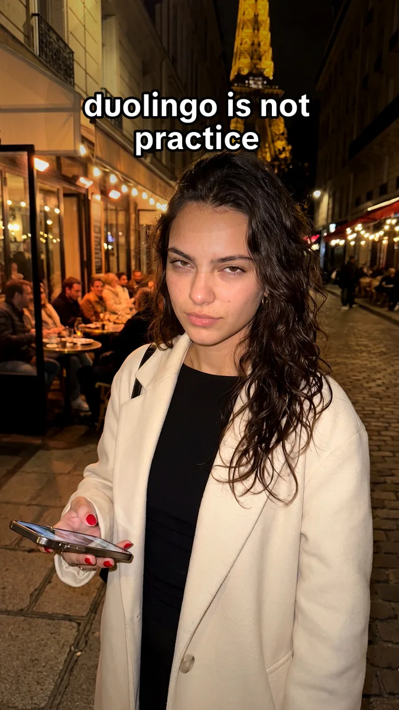
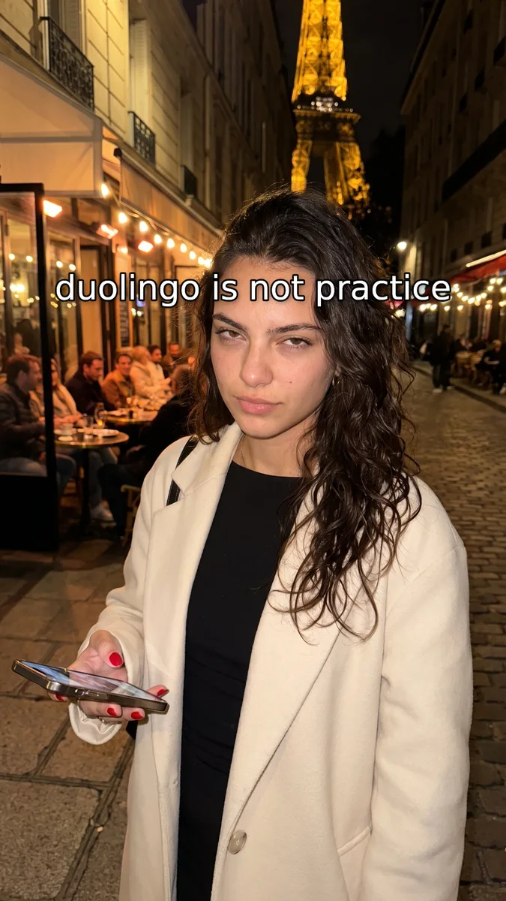

# Generation gallery

The viewer shows media-bearing versions in reverse catalogue order. Full-resolution review copies are public downloads. Source images have metadata stripped; JPEG review copies are re-encoded and are not byte-identical originals.

## The iMessage and lock-screen system

[Browse 54 contexts](https://gnn.fy.studio/sayla-slideshow-guide/v1/index.html#chapter/accepted-native-slideshows) · [Full-resolution image](https://pub-c3929a473c4246739e7cb0bf403c5be2.r2.dev/sayla-slideshow-guide/employee-assets/d53f8fee5708d7030b75979717bb483e95abf0dfb0d0910e556e0e5d85532cbf.png)

The missing accepted renderer has now been recovered, with its existing outputs. A personal hook leads into an authored lock-screen notification or iMessage conversation, then a Sayla payoff. These are historical fictional creatives, not real private chats.

## Workspace speaking-gap survivors

[Browse 12 contexts](https://gnn.fy.studio/sayla-slideshow-guide/v1/index.html#chapter/workspace-speaking-gap) · [Full-resolution image](https://pub-c3929a473c4246739e7cb0bf403c5be2.r2.dev/sayla-slideshow-guide/employee-assets/627f53b4cef4d3c6c0a95dd9f63b6bb59c7d861032cefc816290badb3cea5950.png)

Ten surviving typographic outputs and two review sheets are catalogued as real local bytes. An earlier history note described the eleven-slide concept as captions-only; these files prove surviving outputs, not recovery of the complete eleven-slide sequence.

## August standalone selfie stories

[Browse 6 contexts](https://gnn.fy.studio/sayla-slideshow-guide/v1/index.html#chapter/august-selfie-stories) · [Full-resolution image](https://pub-c3929a473c4246739e7cb0bf403c5be2.r2.dev/sayla-slideshow-guide/employee-assets/204cc1aeb6467ad435008a99ac5a6920ef365caa3caaeea3ad1863fe1d200316.png)

Two standalone concepts use a consistent character and four-card selfie-story treatment. Six eligible generated outputs are shown; an iOS format probe is excluded.

## French for him: four rendered versions

[Browse 25 contexts](https://gnn.fy.studio/sayla-slideshow-guide/v1/index.html#chapter/french-for-him-versions) · [Full-resolution image](https://pub-c3929a473c4246739e7cb0bf403c5be2.r2.dev/sayla-slideshow-guide/employee-assets/937c6512a69fe63b99e20958a050be360d7a65daf0ddc366f065824b06abdfff.jpg)

Original three-slide, three-slide hook, five-slide generated and five-slide onsen-style versions explore one romantic language-learning premise. Duplicate original bytes remain visible in both their original and early-batch contexts.

## Photorealistic w1/w2/w3 scenes

[Browse 24 contexts](https://gnn.fy.studio/sayla-slideshow-guide/v1/index.html#chapter/gpt25-photorealistic) · [Full-resolution image](https://pub-c3929a473c4246739e7cb0bf403c5be2.r2.dev/sayla-slideshow-guide/employee-assets/0ac9835f6ef19976da68f748c0be21e1c37247596b1cb532bfa0ffe8653b08cf.png)

Three Albanian-language directions survive as raw and final photorealistic scenes: the phone call, the wedding and five phrases for Nana. They are not the prompt-only comic trials.

## Single-image Variant Factory runs

[Browse 108 contexts](https://gnn.fy.studio/sayla-slideshow-guide/v1/index.html#chapter/variant-factory) · [Full-resolution image](https://pub-c3929a473c4246739e7cb0bf403c5be2.r2.dev/sayla-slideshow-guide/employee-assets/8400a4f1970163c97ed26bc86ec40d96e16c328ff4befdcc990abe10d22bc9c4.jpg)

Seven July runs contain 105 variant images and three contact sheets. Three recovered review manifests preserve exact overlay and caption copy for 45 entries; unrecovered text stays empty.

## Organic speaking and travel listicles

[Browse 70 contexts](https://gnn.fy.studio/sayla-slideshow-guide/v1/index.html#chapter/organic-speaking-listicles) · [Full-resolution image](https://pub-c3929a473c4246739e7cb0bf403c5be2.r2.dev/sayla-slideshow-guide/employee-assets/bc9c718ed3ee0a578eca5647483ad12d7bf06c220f3b70679642af700470e781.jpg)

Recommendation cards cover fluency routines, meeting family, moving abroad, Sunday reset and related travel/speaking situations. Each dated run keeps its own exact slide copy where a slides record exists.

## Spain packing: three dated listicle runs

[Browse 63 contexts](https://gnn.fy.studio/sayla-slideshow-guide/v1/index.html#chapter/spain-packing-listicles) · [Full-resolution image](https://pub-c3929a473c4246739e7cb0bf403c5be2.r2.dev/sayla-slideshow-guide/employee-assets/8ee117972d6fb835b887abb019bc692438a6627d60a821d4bb1ea9e1e35da55d.jpg)

Three dated runs preserve the same Spain-packing concept. Raw scenes are deduplicated by content hash while every final and run context remains reachable.

## Nine early language-hook stories

[Browse 64 contexts](https://gnn.fy.studio/sayla-slideshow-guide/v1/index.html#chapter/early-language-hooks) · [Full-resolution image](https://pub-c3929a473c4246739e7cb0bf403c5be2.r2.dev/sayla-slideshow-guide/employee-assets/71a0a126abbc612fc57594fb7eab192928e0f6e9d61d45d8dce58bf90c1594eb.jpg)

Nine three-slide concepts test language anxiety, follow-up questions, speaking speed, streaks and romantic motivation. Raw scenes, finals and review sheets remain grouped by their own story ID.

## Tier-3: recovered May batch

[Browse 22 contexts](https://gnn.fy.studio/sayla-slideshow-guide/v1/index.html#chapter/may-tier3-hooks) · [Full-resolution image](https://pub-c3929a473c4246739e7cb0bf403c5be2.r2.dev/sayla-slideshow-guide/employee-assets/7c07147e5e088f586694024d26876c1748ec817270a97fbe685de2bb3c3f30bb.jpg)

A separate May 16 batch preserves the same three story arcs with raw scenes, finals and carousel previews. It is a distinct dated run, not a duplicate label for the July or October records.

## Tier-3: surviving July images, later rerun

[Browse 22 contexts](https://gnn.fy.studio/sayla-slideshow-guide/v1/index.html#chapter/july-tier3-hooks) · [Full-resolution image](https://pub-c3929a473c4246739e7cb0bf403c5be2.r2.dev/sayla-slideshow-guide/employee-assets/a4a7095205fc5bfe269caa1fdb98e6d18c6ae7e8fb6fee503bd1c7c6c9d0ccc9.jpg)

Three concepts follow belief violation, real-world panic and a Sayla speaking-practice payoff. Surviving July images remain valid historical outputs even though the October rerun records failed provider execution.

## The runnable Canvas adaptation

[Browse 9 contexts](https://gnn.fy.studio/sayla-slideshow-guide/v1/index.html#chapter/verified-canvas-drafts) · [Full-resolution image](https://pub-c3929a473c4246739e7cb0bf403c5be2.r2.dev/sayla-slideshow-guide/employee-assets/19b9f7fa4e1c31336fd9d5b37f28b7c644b46d179a2431769d0ffd5e28630799.png)

Three local draft sets produce nine real 1080×1920 PNGs. This is the only currently verified runnable renderer in the package; it is an adaptation of a generic pipeline, not a reproduction of the historical Sayla engines.

